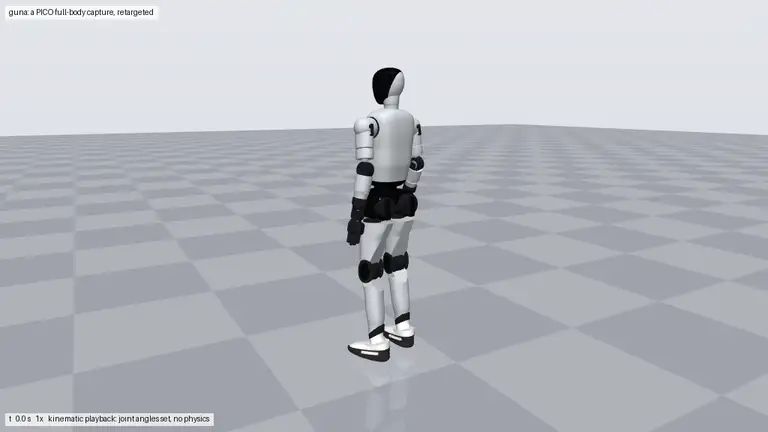
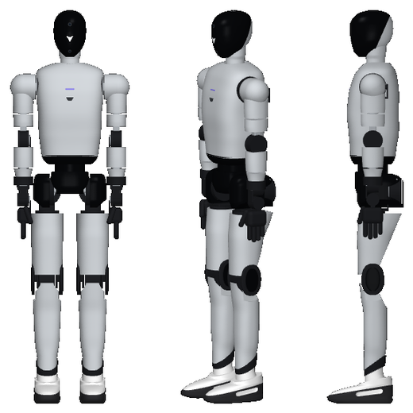
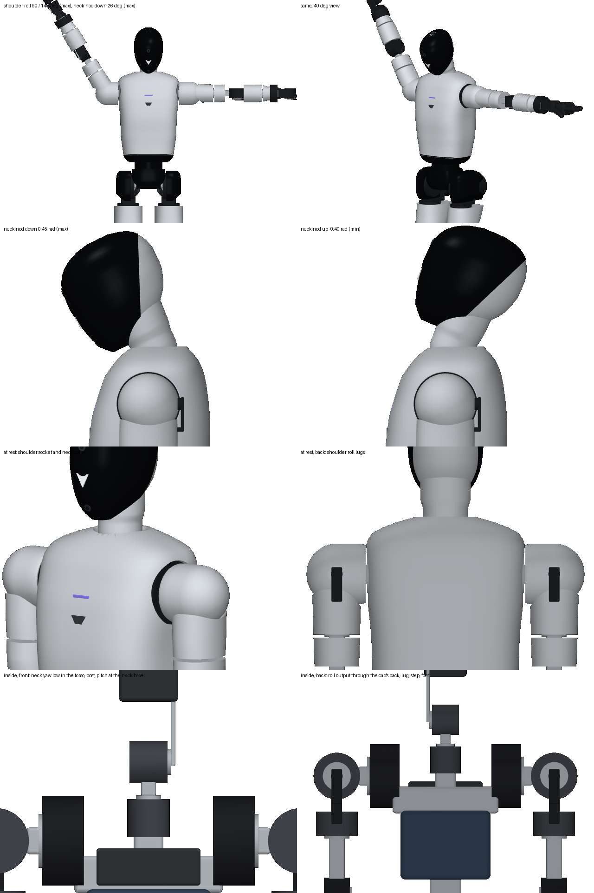

# guna

A 1.727 m humanoid built to Figure 03's published specs and look, with internals we can actually build: an
Asimov 1-style layout (one actuator per joint, 7075 frames, covers over them) around off-the-shelf RobStride
actuators. Built in Fusion by script from one spec, and checked for physically impossible design before and after
every change.



guna walking a PICO full-body capture, retargeted to its joints and played back kinematically (the first 25 s of the
take; [MP4](docs/media/guna_walk.mp4)).



## How it matches Figure 03

| | Figure 03 | guna | how it was checked |
|---|---|---|---|
| height | 1.727 m (5'8") | 1.727 m | spec geometry |
| mass | 61 kg | 56.5 kg | bottom-up: every part from its material (below); the 4.5 kg gap is parts not modelled yet (Figure's tactile hands and palm cameras, cooling, more cabling) |
| battery | 2.3 kWh, 5 h | 2.3 kWh, 13.1 kg | 175 Wh/kg for a cell pack with BMS and case |
| payload | 20 kg | 10 kg short carry, 3 kg continuous (our choice: smaller RS06 elbows, so the arms look like Figure's) | static torque check |
| look | grey knit hood with a glossy black visor leaning forward, grey knit body flowing from the neck into the shoulders and tapering to the waist, oval arms with black elbow discs, black waist column and rounded hip lobes running on into full upper thighs, oval black knee pads with a glossy centre, black wrist cuffs and hands, white sneakers: black outsole with toe spring, a black stripe rising to the heel over a white window, an angled black collar | the same, with inverted triangles where Figure has its logo (we do not use Figure's trademark) | side by side with frames of Figure's reveal video (`tools/compare.py`; the frames are not in this repository) |

Landmark heights and widths were measured on frames of Figure's reveal video and guna was iterated until all of
them are inside tolerance (`reports/compare/compare.md`): chin 1.522 m, shoulder top 1.447, elbow 1.155, wrist
0.955, fingertips 0.72, black waist 1.085, hips 0.86, knee 0.535, head 0.205 x 0.14 x 0.19 m, chest 0.231 deep,
shoulders 0.525 wide, foot 0.289 long. Section by section (side and 60 degree views, the angle Figure's 3/4 frame
was shot from): torso 0.23 deep and tapering to 0.20 x 0.25 at the waist, upper arm 0.11 deep, thigh 0.15 at 0.70 m,
calf 0.12 (Figure's 0.105; the ankle actuators set the limit).

## Inside (Asimov layout, RobStride actuators)

29 actuated joints: legs 6 x 2, waist yaw, neck 2, arms 7 x 2 (hands are 1 kg placeholders).

| joint | axis | range (rad) | actuator | rated / peak N m |
|---|---|---|---|---|
| waist yaw | z | -2.60 .. +2.60 | RS04 | 40 / 120 |
| neck yaw, pitch | z, y | -1.40 .. +1.40, -0.40 .. +0.45 | RS00; the pitch axis is at the neck's base, so the neck tilts with the head as Figure's knit neck bends | 5 / 14 |
| shoulder pitch | y | -3.00 .. +1.00 | RS04 | 40 / 120 |
| shoulder roll | x | -0.05 .. +2.60 | RS06 (88 mm, so the shoulder cap stays small; arms straight out sideways is a short move); output on its back face, out through the cap on the roll axis | 11 / 36 |
| shoulder yaw | z | -2.60 .. +2.60 | RS02 | 6 / 17 |
| elbow | y | -1.90 .. 0 | RS06 (its 88 mm disc is Figure's black elbow; output on the inner face) | 11 / 36 |
| wrist yaw | z | -2.60 .. +2.60 | RS02 | 6 / 17 |
| wrist pitch, roll | x, y | -0.9 .. +0.9, -0.6 .. +0.6 | RS00 | 5 / 14 |
| hip pitch | y | -1.65 .. +0.24 | RS04 | 40 / 120 |
| hip roll | x | -0.35 .. +0.60 | RS04 behind the pitch actuator, driving forward | 40 / 120 |
| hip yaw | z | -1.20 .. +1.20 | RS03 | 20 / 60 |
| knee | y | 0 .. +2.15 | RS04 in the thigh, a 2:1 pushrod to a crank in the knee drum | 80 / 240 |
| ankle pitch, roll | y, x | -0.8 .. +0.55, -0.3 .. +0.3 | 2 x RS06 in the calf, each turning a crank that pushes a rod to the heel of the foot plate (parallel ankle: both rods the same way pitch the foot, opposite ways roll it) | 22 / 72, 13 / 43 |

Totals: 9 x RS04, 2 x RS03, 8 x RS06, 4 x RS02, 6 x RS00 (29). The ankle motors were RS03; RS06 make the calf
10.5 cm deep like Figure's. The static poses use up to 35 N m of their 72 (with the 1.5 margin); fast walking
push-off (60-90 N m) has less headroom than with RS03. Actuator sizes and torques come from retailer listings
(`spec/actuators.json`): confirm with RobStride's datasheets and STEP files before ordering.

### Mass and joint dynamics

Each link's mass, centre of mass and inertia come from its parts (`tools/mass_model.py`, report in
`reports/mass.md`; materials in `spec/robot.py`):

- **Covers:** the 3 mm walls the collision checks use. Knit over PA12 is 1110 kg/m3; polycarbonate gloss covers and
  the visor (a 2 mm layer) 1200; TPU outsole and upper 1200; EVA midsole 250.
- **Frames:** 7075 at 2810 kg/m3 times a fill factor by thickness. Our blocks stand for pocketed or hollow frames:
  plates 0.8, up to 20 mm 0.5, thicker 0.25.
- **Actuators:** catalogue masses, as solid cylinders.
- **Explicit masses:**
  - battery 13.1 kg (Figure's 2.3 kWh);
  - compute module 1.6 kg on the shoulder beam;
  - power board 0.35 kg on the pelvis frame;
  - head electronics 0.3 kg;
  - a wireless charging coil 0.3 kg in each foot (Figure 03 charges at 2 kW through its feet);
  - 0.85 kg of hand internals in each palm.
- **Allowance:** 6 % per link for wiring, fasteners and bearings, on its frames.

| item | kg | share |
|---|---|---|
| actuators | 23.0 | 41 % |
| battery | 13.1 | 23 % |
| 7075 frames (with the allowance) | 8.8 | 16 % |
| covers | 7.0 | 12 % |
| electronics | 2.9 | 5 % |
| hands | 1.7 | 3 % |

The mass check fails above Figure's mass or more than 10 % under it.

Each joint's armature, damping and friction come from the modules that drive it:

- **Armature:** rotor inertia x (gear x linkage ratio)^2.
- **Damping:** viscous damping x ratio^2.
- **Friction:** Coulomb friction x ratio.

For example, the knee's RS04 at 9:1 through the 2:1 pushrod gives 0.065 kg m2, 0.8 N m s and 3 N m. The rotor
inertias are estimates scaled from Unitree's 7520 motor (G1's armature), until RobStride's datasheets.

The shoe works like a knit sock-shoe: what has to turn with the ankle rides on the shank (the white upper above the
shoe's collar line and the angled black collar), so the parts never meet over the ankle's range. Dorsiflexion is 0.8
rad (the deepest pose, a 90 degree squat, uses 0.77).

### Room for the joints

Every joint is swept from its minimum to its maximum with everything else at zero, and nothing may touch, the
covers either side of the joint included (`tools/checks.py`, sweep). Where covers meet at a joint, they are round
about its axis or stop short of it, and the mechanism shows black, as on Figure:

- **Torso openings:** round openings in the torso for the shoulder caps and the neck, and a round opening in the
  pelvis block for the waist column.
- **Arm seams:** seams on the upper arm and forearm at the yaw joints, and a 9 cm elbow zone.
- **Knee hinge:** the shank carries a black drum, round about the knee axis, between the thigh's fork cheeks. The
  thigh and shank covers come down and up to it in concave sockets 4 mm clear, with a 6 deg seam in front and an
  open notch behind where the calf folds up to 123 deg. The oval knee pads ride on the thigh.
- **Hip lobes:** flat inside and underneath (0.86 m, Figure's black-hip line), with round openings 3 mm clear of
  the hip motors where they pass the lobe's faces. The roll motor's rim shows in a slot on the lobe's side.
- **Wrist:** a wrist cuff above the pitch axis.

Ranges trimmed where the covers decide them: elbow 109 deg, knee 123 deg (the deep squat uses 115), hip roll 34 deg
out, hip extension 0.24 rad, wrist pitch 52 deg.

The shoulder and the neck needed new mechanisms, not just room:

- **Shoulder roll** (the arm rising sideways): the cap's outer end is a hemisphere about the point where the roll
  axis crosses the pitch axis, and the arm's top is a socket 4 mm round it, so the arm turns round the cap up to
  149 deg (past 150 the arm's outer top swept over the cap's top; AgiBot A3 stops at 150, Asimov 1 at 90). The roll
  actuator's output faces back: an axle leaves the cap through a round hole on the roll axis (a hole there never
  sweeps) and a short black lug behind the cap steps into the sleeve onto the yaw actuator.
- **Neck pitch:** the axis is at the neck's base, level with the torso's top and crossing the yaw axis. The neck and
  hood are one piece that tilts together, its base a zone of a sphere about the crossing. The torso's opening is
  computed from the swept neck (plus 3 mm): a 9 mm ring at the collar. The nod is 26 deg down and 23 deg up (Asimov 1
  nods 23 / 19).



## Walking: a PICO capture retargeted

`tools/retarget_pico.py` turns a PICO full-body capture (the XRoboToolkit 24-joint skeleton) into guna's joint
angles. It is the X2 retargeter from the author's agibot-x2-record-and-replay and gwbc-supermimic projects (after
GMR), ported to guna's body names:

- The skeleton is morphed to guna's segment lengths along the human's directions.
- Two-stage mink IK follows it frame to frame, with the elbow flex as a posture task.
- New here: planted feet are locked where they landed (the capture's feet drift 5-10 cm per step), and the lowest
  sole is grounded every frame.

On the walking take above (51 s in all):

- Stance feet slide a median 2 cm/s (9 before locking), and no sole goes into the floor.
- No joint sits at a limit more than 1.3 % of the time, except the neck pitch, which reaches its 23 deg look-up
  limit 21 % of the time when the operator looks up.

`tools/render_motion.py` plays a take kinematically: joint angles only, no physics. It renders guna in its own
colours as a movie, with or without the captured operator alongside, or plays it in MuJoCo's interactive viewer
(`--viewer`). The raw capture is not in this repository.

## Checks (`reports/checks.md`: 244 checks, 0 failing)

Carried over from CDX-3R and extended for a robot. Each one was proven on a deliberately broken design first
(`python -I tools/checks.py --bad <case>`: torque, collide, offaxis, floating, mass, poke, window, cover: all caught).

| check | guards against |
|---|---|
| targets, mass | not matching Figure 03's size and proportions; a bottom-up mass over Figure's 61 kg or more than 10 % under it |
| axis | an actuator that is not on its joint's axis |
| static | a rigid part inside another part; a cover touching a link it does not belong next to |
| covers | a cover passing through a motor of its own link or a neighbouring one, its skin closed on its flat cut faces as Fusion draws them |
| connect | rigid parts of a link that do not form one structure (a missing bracket hidden by a cover); covers not mounted; a joint axis that misses a link |
| skin | internal parts poking through the covers (over 0.5 % of a part) |
| sweep | joint limits that cannot be reached without a collision: each joint swept from min to max, rigid parts and the covers' 3 mm walls, the covers across the joint included (only the actuator / flange contact is designed) |
| poses | static torque vs rated (continuous tasks) and peak / 1.5 (short tasks), centre of mass over the feet, joints inside their limits after balancing, collisions, in 10 task poses: stand, walk, carry 3 / 10 kg, deep squat, arms straight out with 5 kg, arms out to the sides, lift 10 kg, single-leg stance, stair step |
| MuJoCo (`tools/sim_stand.py`) | stands and squats to 90 degree knees and back with torques limited to each actuator's peak, with the bottom-up masses and the joints' armature and friction: max tilt 1.0 deg, no saturation |

## Run it

```bash
python -I spec/robot.py
```

```bash
python -I tools/checks.py
```

```bash
python -I tools/mass_model.py
```

```bash
python -I tools/make_robot_files.py
```

```bash
python tools/sim_stand.py
```

```bash
python tools/render_pose.py
```

```bash
python tools/retarget_pico.py <PICO raw tape .npz>
```

```bash
python tools/render_motion.py reports/motion/<take>.npz --view 34 --no-skeleton
```

```bash
python tools/render_motion.py reports/motion/<take>.npz --viewer
```

In Fusion (through the MCP, one short call each): `build.new_document()`, `build.link(name)` for each link,
`build.joints()`, `build.status()`, `build.render(path, view)`, `build.export_stl(folder)`; see
`cad/fusion/build.py`. Change the robot in `spec/robot.py` only (the anchors at the top set the proportions), then
checks, rebuild, compare.

## Files

| path | what |
|---|---|
| `spec/robot.py` → `spec/robot.json` | the one source of truth: kinematics, actuators, materials, shapes |
| `spec/targets.json`, `spec/actuators.json` | Figure 03 targets; actuator catalogue with estimated joint dynamics |
| `tools/checks.py`, `tools/geom.py` | physical checks; shapes and kinematics |
| `tools/mass_model.py`, `reports/mass.md` | bottom-up masses, centres of mass and inertias from the parts' materials |
| `tools/compare.py`, `reports/compare/compare.md` | measurements against Figure 03 |
| `tools/render_pose.py`, `reports/poses.png` | the spec's shapes in any pose, rendered offline |
| `tools/retarget_pico.py`, `tools/ik/pico_to_guna.json` | PICO full-body capture to guna's joint angles (morph and two-stage mink IK, feet locked) |
| `tools/render_motion.py`, `tools/export_web.py` | kinematic playback: movies, MuJoCo's viewer, a web viewer's model and motion |
| `cad/fusion/build.py`, `figlib.py` | Fusion build |
| `cad/guna.step` | the CAD model exported from Fusion: all 30 links at the zero pose, named as in the spec (STEP AP214) |
| `urdf/guna.urdf`, `urdf/guna.xml` | ROS / Isaac and MuJoCo models (meshes from Fusion) |
| `LESSONS.md` | what went wrong here and the rule that now prevents it |

## Next

- Hips: on Figure the black hip pods sit in cups at the thigh tops. Here that needs a different hip layout: the hip
  roll motor sits 10 cm behind the hip centre and reaches 13 cm out, so a cup round about the hip centre that clears
  it would drop the black hips to 0.79 m. It would need a cradle on the hip roll link, a turning seam lower on the
  thigh and a notch in the pelvis block.
- Walking in physics: the PICO takes play kinematically. Walking them in MuJoCo needs a balance controller, such as a
  motion-tracking policy, on the realistic masses and joint dynamics.
- Mass: confirm the rotor inertias, gearing and friction with RobStride's datasheets. Decide whether to close the
  4.5 kg gap to Figure's 61 kg, and with what: a larger battery, heavier hands, or the real frames once they are
  designed.
- Shape: an oval elbow pad over the RS06 (Figure's elbow disc is about 9 x 12 cm, taller than wide).
- Hands: a real dexterous hand model (Figure 03 has 16-DOF hands).
- Internals: replace the actuator cylinders with RobStride STEP models; real brackets in place of the blocks; FEA on
  the hip and knee brackets (CDX-3R stress workflow).
- Fusion: the document's timeline is at about 1,450 features; rebuild into a fresh document before the next round of
  link changes. Its viewport has not been saving images, so the renders here are offline renders of the same shapes.
