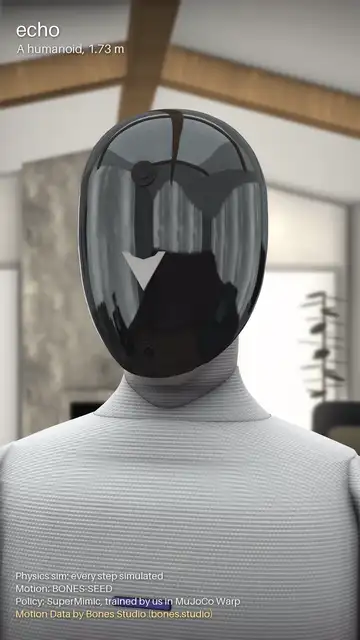
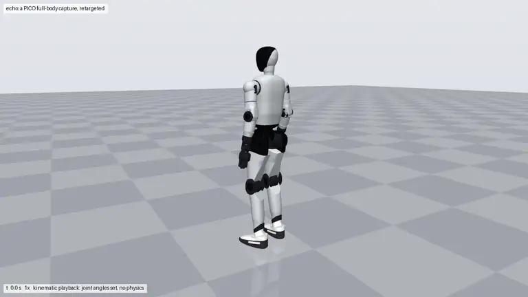
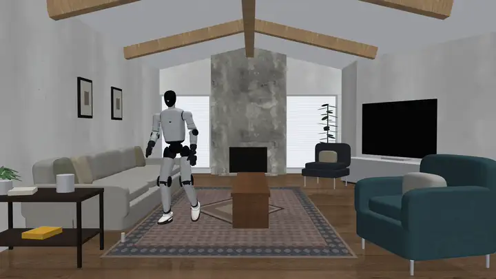
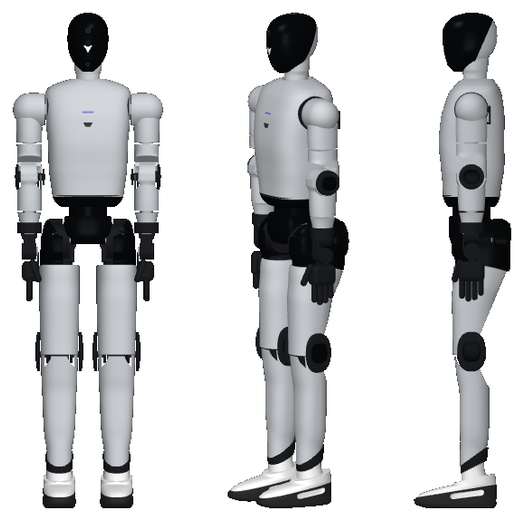

# echo

An open humanoid robot design: 1.727 m tall, 29 joints, built to Figure 03's published specs and look from parts you
can buy. One Python spec generates the CAD, the robot models, the checks and the pictures.

The showcase ([MP4](docs/media/echo_showcase.mp4)): the knit body and glass visor, the machinery under the cover, an
exploded view, then walking, crouching, dancing and being shoved. Every motion shot is a physics sim (MuJoCo, every
step simulated) of a SuperMimic policy we trained in MuJoCo Warp on BONES-SEED motions. Red arrows are the floor's
force on each foot, from the solver. Motion Data by Bones Studio ([bones.studio](https://bones.studio/)). This cut
was rendered from the design as of 2026-11-05 with a policy trained before the latest structural changes; the
exploded view and two short blends are posed, not simulated.

A human motion capture retargeted to echo and played back ([MP4](docs/media/echo_walk.mp4)).

echo tidying a living room: the motion is captured from a public video of Figure 03 at work, retargeted to echo and
replayed in the same room, rebuilt from that video ([MP4](docs/media/echo_livingroom.mp4)).

## Overview

- **Size:** 1.727 m, 62.5 kg (every part's mass from its material; Figure 03 is 61 kg).
- **Joints:** 29: each leg 6, waist 1, neck 2, each arm 7.
- **Actuators:** 29 off-the-shelf RobStride modules (RS00 to RS04 and RS06), each drawn at its maker's outline and
  bolted on its maker's hole patterns.
- **Battery:** 2.3 kWh, the same as Figure 03's.
- **Payload:** 10 kg for a short carry, 3 kg continuously.
- **Deliverables:** URDF and MuJoCo models from the spec; the Fusion 360 design and STEP file are from an earlier
  iteration and not yet rebuilt.
- **Walks:** in MuJoCo with a learned policy: 48 of 48 test walks without a fall; it rides out a 300 N shove at the
  neck and falls to a 650 N one.
- **Checked, honestly:** 1,031 offline checks, of which 79 still fail. They include strength along named load
  paths, contact areas, pins and bearings, screw threads and bolted joints, all proven on broken designs first. The
  failures are mostly the arms and ankles, not yet redesigned, and the stair pose, which the direct knee can't do.
- **Status:** a design in progress, not yet buildable: the legs, hips, waist and chest have real machined parts,
  screws and bearings; the arms, ankles, feet and head are next. Strength figures are hand estimates, not FEA.

## Design

- **Layout.** One actuator per joint, after the open-source Asimov 1:
  - the hips turn pitch, then roll, then yaw;
  - the waist only turns;
  - the knee motor sits on the knee axis and drives it directly;
  - two calf motors drive the ankle through rods.
- **Look.** Figure 03's silhouette, measured section by section from its reveal video: a grey knit body, a black
  visor head, black hips and black joint hubs, and light grey shoes. echo carries its own mark, not Figure's logo.
- **Fabric over machinery.** The grey is a knit garment, one panel per limb, ending at the black hubs, with soft
  gussets at the folds. Underneath, each joint is a round machined housing on its motor's real face, a two-sided fork
  and a closed tube, with real bearings and screws ([joint template](reports/joint_template.md)). Motors and their
  housings are dark, structure is silver.
- **Real parts, honest numbers.** The actuators are sold today, and masses add up from materials. The 1.5 kg over
  Figure's weight stays visible rather than hidden.

The joint table, ranges, masses and how each joint was designed are in [docs/DESIGN.md](docs/DESIGN.md).

## Approach

1. **One spec.** A single robot description places every part relative to a few anchor heights. Everything else is generated
   from it, so a change is one edit.
2. **Check before building.** Offline checks cover:
   - proportions and mass;
   - clearances, and every joint swept through its range;
   - torques and balance in task poses.

   Each check was first proven to catch a deliberately broken design.
3. **Compare with the target.** echo was rendered beside Figure 03's frames at the same scale, and refined section by
   section until it matched.
4. **Build the CAD by script.** Fusion 360 builds the model from the same spec, through MCP.
5. **Export and simulate.** URDF and MuJoCo models carry the bottom-up masses, and a MuJoCo test checks that the
   robot can stand and squat.
6. **Move it.** A motion capture is retargeted to the joints, replayed to check for collisions, and rendered. The
   capture can be a person in a mocap suit, or a video: a body-pose model reads the robot in each frame, the camera is
   calibrated on the room, and the room itself is rebuilt from the same frames.
7. **Make it walk.** A SuperMimic policy is trained in MuJoCo Warp to track BONES-SEED motions on the real robot
   model, then replayed in plain MuJoCo with contact forces recorded. The showcase film's style is written down in
   [docs/showcase_video.md](docs/showcase_video.md) (`tools/render_quality.py`, `tools/showcase.py`).

## Start here

echo is designed and iterated by an AI agent that follows one skill,
[`.claude/skills/humanoid-from-spec/SKILL.md`](.claude/skills/humanoid-from-spec/SKILL.md), with you reviewing
each round. The skill covers finding reference images on the web, measuring them, editing the spec, checking,
comparing, building the CAD, simulating, motion and publishing. The scripts only do the steps; the agent judges the
results with you.

1. Clone the repo and open it in Claude Code; the skill loads automatically. Other agents: start from `AGENTS.md`.
2. Ask for what you want, for example:
   - "Make echo's hips match Figure 03's front view more closely."
   - "Start a new humanoid modelled on the robot in this video: <link>."
3. Review the before/after pictures the agent shows you each round, and say what to change.

The [lessons learned](LESSONS.md) list every trap we hit and how it was fixed. The agent reads them first.

## Repository

- `spec/`: the robot, the one source of truth
- `tools/`: the steps the skill runs: checks, masses, renders, robot models, simulation, motion
- `cad/`: the Fusion design (`echo.f3d`), the STEP file and the build scripts
- `urdf/`: URDF and MuJoCo models with meshes
- `reports/`: check results, masses, strength, the parts sheet and cover-off renders, and studies (fabric cover
  options, internal layout, Figure 01's mechanics)
- `scenes/`: rooms for echo to work in (the living room: layout measured from a video, CC0 textures)
- `docs/`: design details and media
- `.claude/skills/`: the method, as a guide and a Claude Code skill

## Licence

Apache-2.0 ([LICENSE](LICENSE)): use it, change it, build on it. The retargeting adapts GMR (MIT); its notice and
the other credits are in [THIRD_PARTY_NOTICES.md](THIRD_PARTY_NOTICES.md). The walking policy is trained on
Motion Data by Bones Studio ([bones.studio](https://bones.studio/)); use of that dataset is subject to the BONES
Motion Capture Dataset License Agreement, and no motion data is in this repository.

Figure and Figure 03 are trademarks of Figure AI, Inc. echo is an independent project, not affiliated with or
endorsed by Figure AI.
